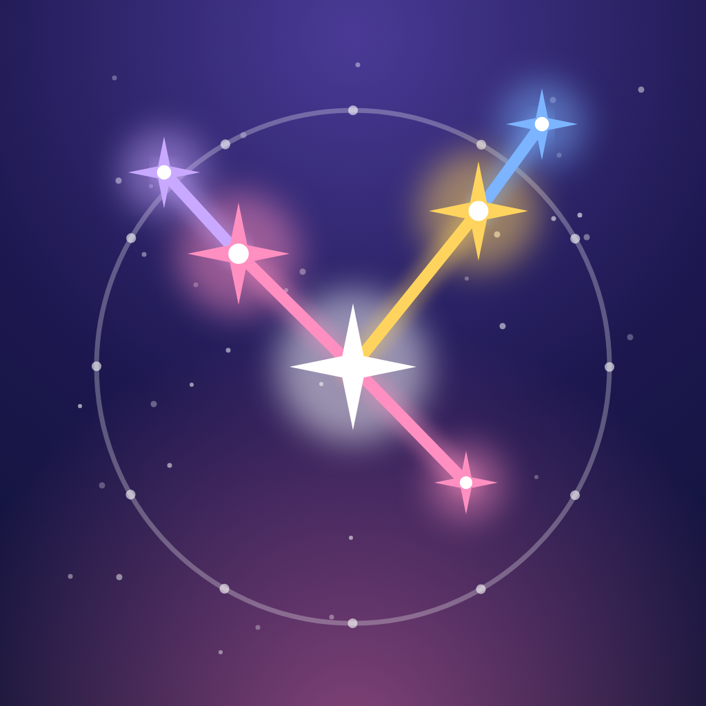
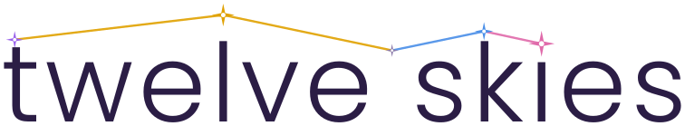

    
  

# Twelve Skies

DES 112 UX/UI final project (working title: Cultural Time App). Twelve Skies is a calm clock whose sky changes color through the day. It includes a Time Constellation of personal memories, Family Traditions and the twelve Chinese Zodiac Hours (十二时辰).

**About the name:** the traditional Chinese day has twelve double-hours (十二时辰), and each one has its own sky. Your memories become stars in that sky.

It is a static web app: one `index.html` plus icons, a manifest and the brand files. It has no server, no build step to deploy, no accounts and **no API keys**. Every file path is relative, so it works from any GitHub Pages address. Memories, traditions and settings are saved in the browser's local storage, so they stay after a refresh. They live on that one device and browser.

## Put it on GitHub Pages

1. Create a new **public** repository on GitHub (for example `twelve-skies`).
2. Click **Add file → Upload files** and drag in everything from this folder, including the folders and the hidden `.nojekyll` file. Commit.
   - On a Mac, press `Cmd + Shift + .` in Finder to show hidden files.
3. Go to **Settings → Pages**. Under *Build and deployment*, choose **Deploy from a branch**, then branch **main** and folder **/ (root)**. Save.
4. After about a minute, your site is live at `https://<your-username>.github.io/twelve-skies/`.

On a phone, open the link and use **Share → Add to Home Screen**. The app installs with the Memory Constellation icon and the name “Twelve Skies.”

## How it displays

- **On a phone**, the app fills the screen. Added to the Home Screen, it opens full screen with the Twelve Skies icon and name, without browser bars.
- **On a desktop browser**, the app stays at exactly iPhone size (390 × 844 px), centered on a plain white page. It is never stretched into a desktop layout. When the window is tall enough, the Twelve Skies wordmark appears above the app. If the window is shorter than the app, the page scrolls instead of shrinking it.

**Customizing the page:** the page around the app is styled at the top of `build/build.py`, in the section marked *The page around the app*. Change the white background, the wordmark (`#brand`) or the spacing (`.page`) there, then run `python3 build/build.py`. You can also edit the same lines directly in `index.html`.

## Handy links

- `?screen=zodiac` opens Zodiac Hours directly. `?screen=constellation` and `?screen=family` work the same way. These are handy for a critique or demo.

## Brand

| Asset | Use |
| --- | --- |
| `brand/twelve-skies-wordmark-dark.svg` | Wordmark for dark backgrounds (light letters, glowing stars) |
| `brand/twelve-skies-wordmark-light.svg` | Wordmark for light backgrounds (dark letters, deeper star colors) |
| `app-icon.png` | App icon, 1024 × 1024 PNG |
| `apple-touch-icon.png` | iPhone Home Screen icon, 180 × 180 PNG |
| `icon.svg` | Browser tab icon (same design, as a vector) |

The wordmark is lowercase “twelve skies” in light, widely spaced letters. A constellation links stars above the t, l and k and the dot of the i, in the four memory colors: lavender (Personal), yellow (Friends), blue (School) and pink (Family). Both SVGs are pure vector shapes with transparent backgrounds, so they look the same everywhere without needing a font.

**Palette:** night `#1D1850` · paper `#F7F2FF` · ink `#2B1D45` · Family `#FF8FC0` · Friends `#FFD45E` · School `#7CB4FF` · Personal `#C9A9FF`

## Files

| File | What it is |
| --- | --- |
| `index.html` | The whole app (ready to deploy) |
| `manifest.webmanifest` | App name, colors and icons for "Add to Home Screen" |
| `brand/` | Final wordmark, light and dark SVGs |
| `icon-explorations/` | The three icon concepts (A Sky Dial, B Memory Constellation, C Zodiac Hour), the final refined B, and before/after previews, for documentation |
| `wordmark-explorations/` | The three wordmark concepts (1 Constellation, 2 Twelve Hours, 3 Sky Serif), each in dark and light SVG, plus the concept board, for documentation |
| `.nojekyll` | Tells GitHub Pages to serve the files as they are |
| `src/Main.dc.html` | The design source the app is built from |
| `build/build.py`, `build/dc-lite.js` | Rebuild script and the small runtime it bundles |

To rebuild after editing `src/Main.dc.html`, run `python3 build/build.py`. This only needs Python 3.

## Test locally

Run `python3 -m http.server` in this folder, then open http://localhost:8000.
